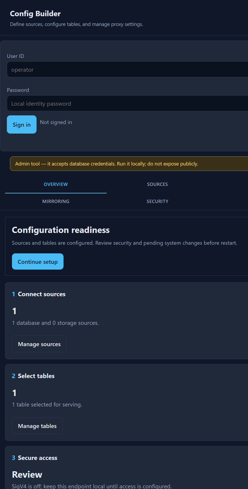
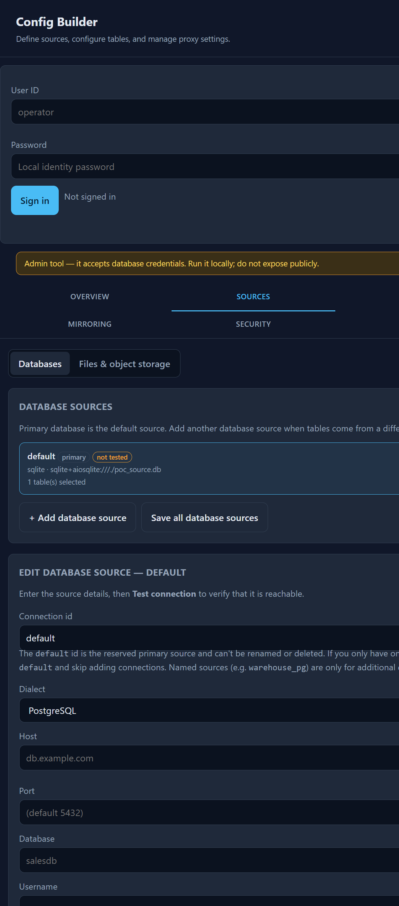
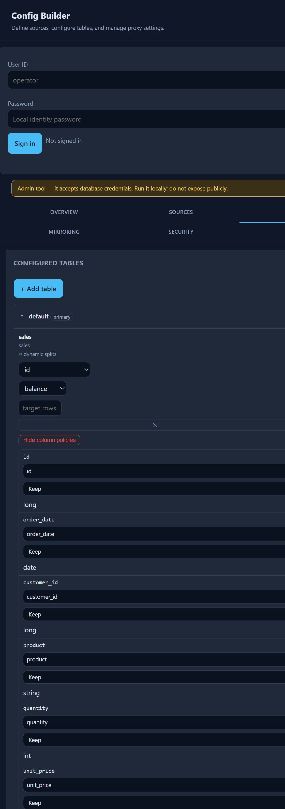
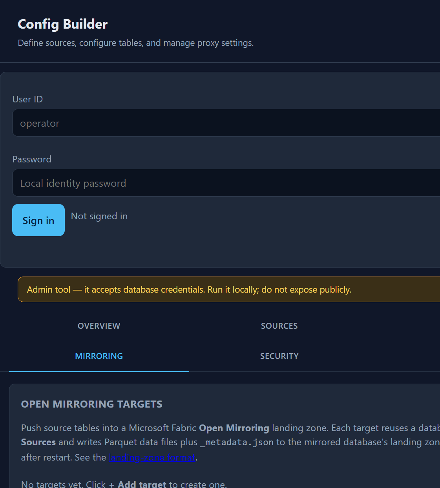
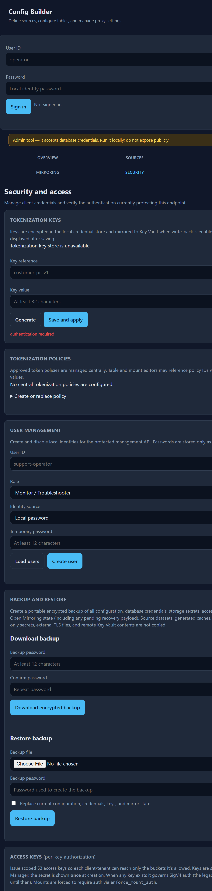
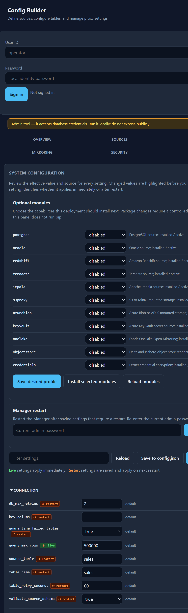

# Config Builder Guide

The Config Builder is the browser interface for sources, served tables, Open
Mirroring targets, tokenization policies, credentials, and runtime settings. It
writes the split `config.*.json` files and encrypted credential store used by the
proxy.

Open `/_config/` on the Lite proxy port or Manager control-plane port. For
example, a local Enterprise Manager normally serves `http://localhost:9200/_config/`.
Keep the page on a private network and configure Manager authentication before
using it outside a local lab.



### Conditional configuration writes (source patch, not released 3.1.0)

`GET /_config/api/current` returns an opaque `ETag` and `Cache-Control: no-store`.
The native response is unchanged: `settings` is an effective-settings array, not
a typed source/table snapshot. Pass the exact strong ETag in `If-Match` to
`POST /_config/api/save` or `POST /_config/api/apply`. Successful writes return
the new ETag. A mismatch returns HTTP 409, `application/problem+json`, code
`stale_revision`, and a matching body/header correlation ID, before applying live
settings or writing files. Re-read before retrying. Wildcards, weak tags, and
lists are not supported. Existing callers that omit `If-Match` remain
unconditional for compatibility.

These operations and `config.write_config_updates` share a reentrant process
lock and an OS file lock at `.fsp-configuration.lock` in `FSP_CONFIG_DIR` (or the
working directory). The directory must be writable, and processes sharing
configuration must use the same directory on a filesystem that supports shared
advisory locks. Do not remove the lock file while processes are running.
The revision covers persisted configuration and encrypted credential-store bytes and explicit environment
overrides, not process-local defaults or import-time snapshots.
Edits made outside these cooperating writers are detected at the next read or
revision check but are not serialized with an in-progress write. This does not
make multi-file writes rollback-atomic, protect credential-store operations, or
add conditional writes to other endpoints.

### Operator API errors (source patch, not released 3.1.0)

Errors from Catalog `/catalog`, Config Builder `/_config/api`, and Manager
operator APIs use `application/problem+json`. The Manager paths include
`/_manager/api`, `/_monitor/api`, `/_admin`, `/agents`, and operator `/control`
routes. On standalone Agents, the boundary covers `/_config/api`,
`/_monitor/api`, and `/_admin` only. Agent control routes, S3 responses,
health probes, and HTML pages keep their existing protocols.

Every problem contains `type`, `title`, `status`, `code`, and `correlationId`.
The same ID appears in `X-Correlation-ID` and structured error logs. A caller
can supply an ID of up to 128 characters matching
`[A-Za-z0-9][A-Za-z0-9._:-]*`; invalid IDs are replaced. Error responses use
`Cache-Control: no-store`. FastAPI request-validation lists are replaced
without echoing submitted values, server errors have generic details, and
retained legacy error fields are scrubbed. URLs in those fields are replaced
with `[REDACTED URL]`, including malformed and signed URLs.

The generic codes for HTTP 400, 401, 403, 404, 405, 406, 409, 422, 428, 429,
500, 503, and 504 are `bad_request`, `authentication_required`,
`permission_denied`, `not_found`, `method_not_allowed`, `not_acceptable`,
`conflict`, `validation_error`, `precondition_required`, `rate_limited`,
`internal_error`, `service_unavailable`, and `gateway_timeout`, respectively.
Specific codes include `stale_revision`, `configuration_not_representable`,
`configuration_persist_failed`, and `residency_policy_violation`. OpenAPI
documents the shared problem schema and configuration revision headers.

### Typed source/table contract (opt-in source patch)

Send `X-FSP-Configuration-Contract: 3.1.0` on **every** typed
`GET /_config/api/current`, `POST /_config/api/apply`, or
`POST /_config/api/save`. Without this header, the browser keeps its existing
settings-array response and native mutation format. An unsupported header value
returns 406 rather than falling back to native interpretation.

An opted-in current response is exactly a settings object:

```json
{
  "settings": {
    "connections": [{
      "id": "default",
      "database_url_reference": {
        "kind": "fsp_credential_store",
        "reference": "fsp-credential://default"
      },
      "query_timeout_seconds": 300,
      "query_max_rows": 500000,
      "max_retries": 3,
      "retry_backoff_seconds": 1,
      "validate_source_schema": true
    }],
    "tables": [{
      "name": "orders",
      "source_table": "public.orders",
      "key_column": "id",
      "connection": "default",
      "schema": [{"field_id": 1, "name": "id", "type": "long", "nullable": false}]
    }]
  }
}
```

This is **saved state**, re-read from disk under the revision lock, not a claim
that agents have loaded it. Successful typed responses echo the contract header,
include the strong `ETag`, `Cache-Control: no-store`, and
`Vary: X-FSP-Configuration-Contract`. Optional null fields are omitted.

For each write send the exact last ETag in `If-Match`. Replace one complete
section per request:

```http
POST /_config/api/apply
X-FSP-Configuration-Contract: 3.1.0
If-Match: "<etag from current>"
Content-Type: application/json

{"settings":{"connections":[<complete desired connection list, including default>]}}
```

Then send `{"settings":{"tables":[<complete desired table list>]}}` with the ETag
returned by the connections write. Both routes return
`{"ok":true,"settings":{"connections":[...],"tables":[...]},"applied_live":[],
"restart_required":["connections"]}` (or `["tables"]`), with a new ETag.
The response includes persisted readback, checked against the requested state.
There is no live source/table apply. Restart the Manager/Agents after completing
the sequence. The two requests are not one rollback-atomic operation.

Missing `If-Match` returns 428. A stale or non-exact value returns the existing
409 `stale_revision` Problem Details response without changing configuration or
credentials. Unrepresentable state and unsupported inputs return 422 with code
`configuration_not_representable`; write failures return 500 with code
`configuration_persist_failed`. Validation diagnostics never echo supplied
credentials. Existing authentication middleware and `config.write` enforcement
still apply; the opt-in header grants no permission and exposes no credential
values.

#### Supported references and native persistence

Only `fsp_credential_store` references are supported. The canonical syntax is
`fsp-credential://<record-id>`. A database reference names an existing, decryptable
**URL record**, not a database URL or arbitrary secret blob. The record id must
match `[A-Za-z0-9][A-Za-z0-9_-]{0,127}`. Paths, trailing slashes, userinfo,
ports, query strings, fragments, percent encoding, and embedded credentials are
not accepted. The literal lowercase `fsp-credential://` prefix is required for
canonical references; no general-purpose URI parsing or decoding is performed.
The native default section and named entries persist it as
`"db_url_reference":{"kind":"fsp_credential_store","reference":"fsp-credential://<record-id>"}`.
The native loader extracts the record id and resolves that record on startup.
No database URL is returned,
copied to configuration, or inserted into the credential store by typed writes.
Removing a source never deletes its stored credentials.
Native saves also replace the default connection's previous URL or reference
when switching between the two forms. Supplying both a non-empty `db_url` and
`db_url_reference` in one update is rejected before persistence.

`azure_key_vault` URLs and `kubernetes_secret` references return 422. Existing
Key Vault startup hydration can populate the encrypted local store using the
existing naming/authentication setup; refer to that **local record** afterward.
Typed requests do not contact a vault, provision secrets, or invent reference
names. The same store path and decryption identity/key must be available to the
Manager and agents. Conflicting `DB_URL` / `DB_URL_<ID>` overrides are rejected
instead of silently redirecting a saved reference. Other runtime overrides retain
native precedence; saved settings are not runtime telemetry.

Connections require unique ids, distinct native environment names, and exactly
one `default`. Optional query controls default to the values shown above when
omitted in a write. The default is stored in the singular native `connection`
section; named sources remain in `connections`. Retry fields translate to
`db_max_retries` and `db_retry_backoff_seconds`. The loader accepts the canonical
`query_timeout_seconds` / `db_retry_backoff_seconds` settings emitted by the writer,
with legacy `query_timeout` / `db_retry_backoff` as read fallbacks.

Tables support `name`, `source_table`, `key_column`, `connection` (default
`default`), optional positive `num_splits` and `split_target_rows`,
`split_strategy` (`auto`, `modulo`, `range`, `date`), `split_balance` (`span`,
`count`), and `schema`. Columns support `field_id`, `name`, optional `source`,
`type`, `nullable`, and optional `transform`. Transform fields are `kind`,
`key_reference`, `domain`, and `normalization`. A transform key reference uses
the same `fsp-credential://<record-id>` syntax and must name an existing local
tokenization-key record. Tokenization record ids retain their native lowercase
letters/numbers/hyphens restriction. The reference translates to native
`key_ref` with its canonical spelling intact, never to the key value. Native transform, split-key, schema, and source
capability validation also apply. An explicit empty table list stays empty after
restart and passes startup validation, allowing a Manager or Agent to run
without configured source tables.

Bare record ids remain accepted for compatibility. Neither form is normalized
on save or read: canonical references remain canonical and bare references remain
bare, so readback does not change the supplied reference or its input hash.
New Orchestrator requests should always use the canonical form. Both forms resolve
to the same underlying record id without creating or renaming credential records.

#### Existing configurations and release prerequisites

The API does not silently migrate legacy state. Before using typed current/apply,
an operator must persist an explicit default connection section using
`db_url_reference`, named reference-based connections, and an explicit `tables`
array (which can be empty). Provision URL and tokenization-key records through
the existing authorized credential flow first. Inline/redacted/implicit database
URLs, missing or unreadable records, fractional retry backoffs, disabled-table
flags, policy selections, byte-split controls, and other fields outside this
contract are rejected rather than omitted from a snapshot or overwritten.
Unrelated top-level configuration sections and default single-table fallback
settings are preserved; typed writes do not manage them.

Ship this source patch in a new Manager/Agent runtime image before enabling
Orchestrator typed apply. Mount writable configuration on a shared-lock-capable
filesystem, migrate legacy state deliberately, provision the encrypted store
without sharing plaintext credentials, and retain the deployment's authentication
and `config.write` role assignment. Verify release negotiation and post-restart
runtime behavior in the deployment. Source tests do not certify a deployed image,
cloud connectivity, role assignments, or distributed credential-store locking.

## 1. Sign in and review readiness

Sign in with a local identity or the configured Manager credentials. An OIDC
bearer token can also identify an operator when OIDC is configured. The Overview
page shows the number of sources and tables, the current security posture, and
whether a restart is needed.

The page can display controls that your current account cannot use. The server
still enforces every request. A monitor or troubleshooter can inspect health but
cannot save configuration, credentials, policies, or users.

## 2. Add and test sources

Open **Sources**, choose **Databases**, then select the default source or **Add
database source**. The default source is the primary connection. Add named
sources only when tables use another database or dialect.



Choose the dialect, host, database, and authentication method. For Databricks,
enter the SQL warehouse HTTP path. Select **Test connection** before saving. A
test checks the driver, network route, credentials, and source response; it does
not publish a table.

Select **Save source** to store a credential in the encrypted credential store.
The password is not returned to the browser after saving. Use **Save all database
sources** when staged changes span several sources.

Saved source rows have **Edit** and **Validate** actions. Edit restores the
non-secret connection fields and leaves password, token, and client-secret fields
blank. Validate uses the credential already held by the Manager, so a saved source
can be checked after restart without entering its password again. A successful
validation also makes that saved source ready for table changes; it is not necessary
to open, test, and save an unchanged source before adding a table.

Use **Files & object storage** in the same tab to configure local, S3-compatible,
or Azure mounts. A mount bucket must not reuse the warehouse bucket name.

## 3. Select tables and splits

Open **Tables**. Tables are grouped by source. Expand a source to change a table's
split key, strategy, balance, split count, and target rows.



Choose a stable key. Use `range` for large integer keys, `date` for temporal
keys, and `modulo` for predictable full scans. `auto` selects an eligible strategy.
Use `count` balance for skewed keys when the source supports the required planning
query. A disabled table remains in configuration but is not resolved or published.

Databricks and Impala do not use primary-key reflection to choose a split key.
Their key selector remains blank after inspection; explicitly select a reflected
column before applying the table. The server validates that the selection exists
in the reflected source schema and refuses to plan from an inferred key.
See the [source capability matrix](SOURCE_CAPABILITIES.md) for the affected
dialects, fallback costs, and live-test requirements.

Select **Apply table changes** after edits. A source, table, split, output-format,
or schema change generally requires a Manager restart before every process uses
the new configuration.

## 4. Configure column policies

In an expanded table, select **Edit columns**. If the table uses an inferred schema,
the builder validates it against the saved source and loads its columns before
opening the editor. **Validate** refreshes source metadata and preserves existing
output names and tokenization settings. A green **validated** badge confirms that
the source columns and split key passed validation. Reflected output names are
normalized for Parquet and SQL compatibility: spaces and punctuation become
`_`, leading numbers receive a `_` prefix, and collisions receive a
numeric suffix. For example, `Order Total` becomes `Order_Total`. The original
source name remains in the mapping used to read the database. The split key is
locked to **Keep**. For each other column, select Keep, Deterministic token,
Random token, or Remove, and set the output name when needed.


**Remove** omits the column from the published schema and Parquet output.
**Deterministic token** preserves equality for normalized values. **Random token**
changes on every source read and cannot be used with content-hash refresh.

Token options are unavailable until an approved central policy exists. Create a
key and policy in Security first, then return to this editor and select the policy
that matches the chosen token type.

## 5. Configure Open Mirroring

Open **Mirroring** to configure Fabric Open Mirroring landing-zone targets. Each
target references a database source from **Sources**. Add a target, choose its
source connection, Fabric workspace and mirrored database, landing-zone root,
and the source tables to publish.



Use a non-null watermark that advances for every source change when incremental
upserts are required. Omit the watermark only when a full snapshot scan and delete
detection are acceptable. Before the first run, select **Check health** in the
target editor. It verifies source access, control columns, landing-zone access,
Manager credentials, and Fabric mirror status without writing data.

Save the target before selecting **Dry run** or **Publish saved targets**. The
publish actions use saved targets and return a background job. The page keeps its
latest job state while the Manager remains running.

## 6. Manage keys, policies, and access

Open **Security** to manage encrypted credentials and privileged configuration.
These controls require the matching function permission.



### Tokenization keys

Enter a logical key reference, such as `customer-pii-v1`, and a key value, then
select **Save and apply**. The store encrypts the value and shows only its status
later. A durable policy references this logical name; the policy file never
contains the key value.

### Tokenization policies

Create an approved durable or random policy. A durable policy needs a key
reference, domain, and normalization rule. A random policy has no key reference.
Choose the policy from a table, mount, or mirror column editor after it is saved.
Disable a policy instead of deleting it when historical snapshots or configuration
still identify it.

### User and access-key management

Create local users with a role and a password of at least 12 characters, or create
an OIDC subject without a local password. Roles grant named functions; do not use
an OIDC token role claim as a proxy permission.

Create a scoped S3 access key for each Fabric client or tenant. The key secret is
shown once at creation. Restrict its allowed buckets and prefixes, then store the
secret in the Fabric connection.

### Backup and restore

Download a password-encrypted backup before a broad configuration change. Restore
replaces configuration, credentials, access keys, and mirror state only after an
explicit confirmation. Restart the Manager after a successful restore.

## 7. Review and apply runtime settings

Open **System** to inspect effective settings and save staged changes. Values from
the process environment override values saved in config files. The page identifies
an active environment override; saving the JSON file does not change that running
value.



A restart is required for structural settings such as listener ports, source URLs,
TLS files, Agent count, materialization mode, and Manager authentication. Cache,
split, and selected observability settings can be live, but confirm their status
in the saved response before relying on them.

## 8. Verify after changes

1. Confirm `/_config/api/authorization/me` shows the expected identity and permissions.
2. Check `/healthz` and `/readyz` after a restart.
3. Use `/_admin/objects?table=<name>` when Fabric reports an object-size mismatch.
4. Use the Manager monitor to inspect Agent registration, source errors, memory, and Open Mirroring jobs.
5. Run the relevant tokenization or Open Mirror UAT before production rollout.

See [Chapter 5: Configuration](manual/05-configuration.md) for configuration
precedence, [Chapter 13: Open Mirroring](manual/13-open-mirroring.md) for the
publishing contract, and [Chapter 14: Tokenization policies](manual/14-tokenization-policies.md)
for policy lifecycle and rotation.
